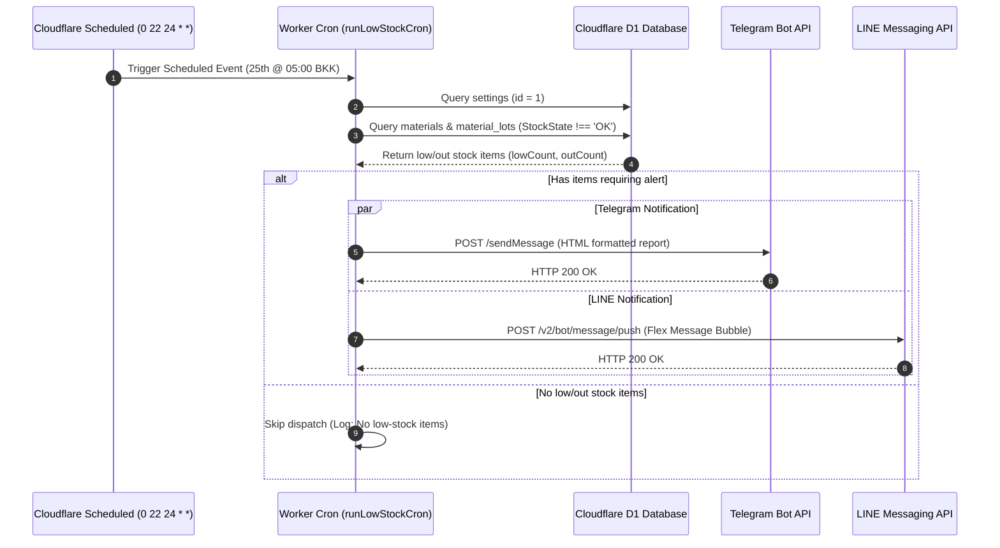

# Technical Design: Monthly Stock Alert (Telegram + LINE)

* **Author:** chookaittom-gif
* **Status:** Proposed
* **Date:** 2026-11-10

---

## Overview

ระบบแจ้งเตือนพัสดุคงคลังต่ำกว่าเกณฑ์และหมดสต็อก (Low & Out of Stock Notification) อัตโนมัติไปยังช่องทาง **Telegram** และ **LINE Official Account (LINE Messaging API)** ทุกวันที่ 25 ของเดือน เวลา 05:00 น. (เวลาประเทศไทย UTC+7) เพื่อเตรียมความพร้อมสำหรับรอบจัดซื้อประจำเดือน พร้อมทั้งปรับปรุงรูปแบบข้อความ (Template & Flex Message) ให้สวยงาม อ่านง่าย และเป็นระเบียบ

---

## The Problem

1. **Alert Fatigue และผิดรอบการทำงาน**: เดิมระบบตั้ง Cron ส่ง Telegram ทุกเช้าเวลา 08:00 น. ทำให้เกิดข้อความซ้ำซ้อนทุกวันจนผู้ดูแลมองข้าม ขณะที่กระบวนการจัดซื้อจริงต้องการข้อมูลสรุปเป็นรอบประจำเดือน (ทุกวันที่ 25 เพื่อเตรียมการจัดซื้อปลายเดือน)
2. **ขาดการแจ้งเตือนทาง LINE**: ปัจจุบัน Cron ตรวจสอบสต็อกรองรับเฉพาะ Telegram แม้ว่าระบบจะมีการตั้งค่า `line_token` และ `line_to` อยู่ในฐานข้อมูลแล้ว แต่ยังไม่ได้เชื่อมต่อเข้ากับ Cron สำหรับเตือนสต็อก
3. **รูปแบบข้อความยังไม่สวยงามและขาดมิติ**: ข้อความแจ้งเตือนเดิมเป็นเพียงข้อความตัวอักษรธรรมดา ไม่มีมิติความสำคัญระหว่างพัสดุที่ "หมดแล้ว (Critical)" กับพัสดุที่ "ใกล้หมด (Warning)" และยังไม่มี Flex Message สำหรับ LINE

---

## Goals

1. **Multi-Channel Notification**: รองรับการส่งแจ้งเตือนทั้ง Telegram และ LINE ไปยังกลุ่มหรือผู้ดูแลที่กำหนดไว้ใน `settings`
2. **Monthly Schedule (25th @ 05:00 AM BKK)**: ปรับรอบเวลาการทำงานของ Scheduled Cron ให้รันทุกวันที่ 25 ของเดือน เวลา 05:00 น. (เวลาไทย UTC+7 / ตรงกับวันที่ 24 เวลา 22:00 UTC)
3. **Aesthetic Message Formatting**:
   * **LINE**: ส่งเป็น Flex Message (Bubble layout) สีสันชัดเจน แยกแถบสีแดงสำหรับ "หมดสต็อก (OUT)" และสีส้มสำหรับ "ใกล้หมด (LOW)" พร้อมปุ่มกดเข้าดูในระบบ
   * **Telegram**: จัดรูปแบบ HTML Message ใหม่ ใช้ Emoji, Bold header, Code block แบ่งหมวดหมู่ให้อ่านง่าย ชัดเจน
4. **Zero Breaking Schema**: ใช้ตาราง `settings` และข้อมูลเดิม ไม่เพิ่ม Table ใหม่และไม่กระทบโครงสร้างข้อมูลพัสดุ

---

## Non-Goals

1. **ไม่เปลี่ยนแปลงเกณฑ์คำนวณ StockState**: การตัดสิน `OUT` (<=0) และ `LOW` (<= MinQty) ยังคงใช้ฟังก์ชันเดิม
2. **ไม่มีการสั่งซื้ออัตโนมัติ**: ระบบมีหน้าที่สรุปแจ้งเตือนเท่านั้น การสั่งซื้อยังคงเป็นไปตามระเบียบงานพัสดุของหน่วยงาน
3. **ไม่เปลี่ยนพฤติกรรมการแจ้งเตือนคำร้องขอเบิก**: การแจ้งเตือนขอเบิกใหม่/อนุมัติ/ไม่อนุมัติ ยังทำงานแบบ Event-driven ตามปกติ

---

## Open Questions

* **คำถามที่ 1 (LINE Flex Fallback)**: หากพัสดุที่ใกล้หมดมีจำนวนมาก (เช่น เกิน 20 รายการ) จะจำกัดรายการใน Flex Bubble ไว้ที่กี่รายการ (เช่น 15 รายการแรก) เพื่อไม่ให้ติดข้อจำกัดขนาด Message payload (30KB) ของ LINE API?
* **คำถามที่ 2 (Admin Manual Trigger)**: ควรมีปุ่ม "ทดสอบส่งแจ้งเตือนสต็อก (Telegram + LINE)" ในหน้าตั้งค่าผู้ดูแลระบบเพื่อใช้พรีวิวข้อความด้วยหรือไม่?

---

## Critical User Journeys (CUJs)

### CUJ 1: Scheduled Notification on the 25th of the Month
* **Given**: มีพัสดุที่มีสถานะ `OUT` หรือ `LOW` ในระบบ และมีการเปิดตั้งค่าแจ้งเตือน Telegram / LINE ใน `settings`
* **When**: ถึงเวลา 05:00 น. (UTC+7) ของวันที่ 25 ของเดือน (Cloudflare Worker Scheduled Event ทำงาน)
* **Then**: 
  1. ระบบดึงรายชื่อพัสดุที่ `StockState !== 'OK'`
  2. แปลงข้อมูลเป็น Telegram HTML Message ส่งเข้า Telegram Chat ID ที่ระบุ
  3. แปลงข้อมูลเป็น LINE Flex Message ส่งเข้า LINE Destination ที่ระบุ
  4. บันทึกผลการส่งลง Log สำเร็จ

### CUJ 2: Alert Formatting Presentation
* **Given**: มีรายการพัสดุหมดสต็อก 1 รายการ และใกล้หมด 10 รายการ
* **When**: ผู้ดูแลเปิดดูข้อความใน LINE หรือ Telegram
* **Then**: 
  1. หัวข้อระบุชัดเจนว่าเป็น "รายงานสรุปสต็อกพัสดุประจำเดือน (วันที่ 25)"
  2. มีการสรุปตัวเลขสถิติรวม (หมดสต็อก: X รายการ, ใกล้หมด: Y รายการ)
  3. แสดงรายการแยกหมวดหมู่อย่างเป็นระเบียบ มีรหัสพัสดุ ชื่อพัสดุ จำนวนคงเหลือ และหน่วยนับ

---

## Technical Plan (Architecture)

### 1. High-Level Architecture & Execution Flow



### 2. Scheduled Trigger Configuration (`cloudflare/wrangler.jsonc`)

* **Schedule Expression**: `"0 22 24 * *"`
  * **Minute**: `0`
  * **Hour**: `22` (UTC) = `05:00` (UTC+7, เวลาประเทศไทย)
  * **Day of Month**: `24` (UTC) = วันที่ `25` ของทุกเดือนตามเวลาประเทศไทย
  * **Month**: `*` (ทุกเดือน)
  * **Day of Week**: `*` (ไม่จำกัดวันในสัปดาห์)
* **Safe Check in Cron Handler**: เพิ่มการอ่านเวลาปัจจุบันแบบบางกอก `nowBkk()` เพื่อบันทึก Timestamp ใน Log ยืนยันการรันตรงรอบวันที่ 25

### 3. Settings Retrieval & Notification Config Expansion

ใน `cloudflare/src/lib/telegram.ts` (หรือ `cloudflare/src/lib/notify.ts`):
* ขยายโครงสร้าง `NotifyConfig` ให้คืนค่า `lineToken: string` และ `lineTo: string` จากฟิลด์ `line_token` และ `line_to` ในตาราง `settings`
* ตรวจสอบ flag การเปิดใช้งานแยกช่องทาง: `cfg.notifyTelegram` และ `cfg.notifyLine`

```typescript
export interface NotifyConfig {
  token: string;          // Telegram bot token
  chatId: string;         // Telegram chat ID
  lineToken: string;      // LINE channel access token
  lineTo: string;         // LINE user ID or group ID
  onLowStock: boolean;    // notify_low_stock === 'YES'
  notifyTelegram: boolean;// notify_telegram !== 'NO'
  notifyLine: boolean;    // notify_line !== 'NO'
  schoolName: string;
}
```

### 4. Presentation & Message Design

#### 4.1 Telegram HTML Message (`lowStockText`)
จัดโครงสร้างข้อความใหม่โดยแยกหมวดหมู่อย่างเด็ดขาด:
1. **Header & Context**: ระบุชื่อระบบและรอบวันที่ 25
2. **Dashboard Summary**: แสดงตัวเลขอัตราส่วน `หมดสต็อก` (สีแดง) และ `ใกล้หมด` (สีส้ม/เหลือง)
3. **หมวดหมู่ 🚨 หมดสต็อก (0 หน่วย)**: แสดงรายการที่มี StockQty = 0 ลำดับแรก
4. **หมวดหมู่ ⚠️ ใกล้หมดสต็อก**: แสดงรายการที่มี StockQty <= MinQty พร้อมระบุเกณฑ์ขั้นต่ำ
5. **Truncation Guard**: หากมีรายการรวมเกิน 20 รายการ ให้ตัดแสดง 20 รายการแรก และระบุ `... และอีก N รายการ ดูรายละเอียดเพิ่มเติมในระบบ`

#### 4.2 LINE Flex Message (`lowStockFlex`)
สร้าง Component Flex Message ใหม่ใน `cloudflare/src/lib/lineFlex.ts`:
* **Container**: `bubble` (size: `mega`)
* **Header**: สี `#DC2626` (Red-600) หรือ Gradient โทนอุ่นสำหรับแจ้งเตือนพัสดุ
  * Title: `"⚠️ แจ้งเตือนสต็อกพัสดุประจำเดือน"`
  * Subtitle: `"รอบวันที่ 25 | [ชื่อหน่วยงาน]"`
* **Body**:
  * **Stats Block**: กล่อง 2 คอลัมน์ (คอลัมน์ซ้าย: หมดสต็อก สีแดง / คอลัมน์ขวา: ใกล้หมด สีส้ม)
  * **Separator**: เส้นแบ่งบาง `#E5E7EB`
  * **Item Rows**: จัด Layout แถวละ 1 รายการ:
    * ชื่อและรหัสพัสดุ (Text wrap, สี `#1F2937`)
    * ป้ายจำนวนคงเหลือ (Badge pill สีแดงสำหรับ 0, สีส้มสำหรับน้อยกว่าเกณฑ์)
* **Footer**:
  * ข้อมูลแจ้งเตือนจำนวนคงเหลือเพิ่มเติม (กรณีเกิน 15 รายการ)
  * ปุ่ม Action `"เปิดดูทะเบียนพัสดุ"` (URI Action นำไปยัง URL ระบบ)

### 5. Multi-Channel Dispatch Logic (`cloudflare/src/cron.ts`)

ปรับฟังก์ชัน `runLowStockCron(env: Env)` ให้ประมวลผลแบบขนานและดักจับ Error อิสระต่อกัน:

```typescript
export async function runLowStockCron(env: Env): Promise<void> {
  try {
    const cfg = await getNotifyConfig(env);
    if (!cfg.onLowStock) return;

    const low = (await listMaterials({ env } as Ctx)).filter((m) => m.StockState !== 'OK');
    if (!low.length) return;

    const tasks: Promise<unknown>[] = [];

    // Telegram Dispatch
    if (cfg.notifyTelegram && cfg.token && cfg.chatId) {
      tasks.push(
        sendTelegram(cfg.token, cfg.chatId, lowStockText(low, cfg.schoolName))
          .then((res) => { if (!res.ok) console.error('telegram low-stock failed', res.message); })
      );
    }

    // LINE Dispatch
    if (cfg.notifyLine && cfg.lineToken && cfg.lineTo) {
      const flexMsg = lowStockFlex(low, cfg.schoolName);
      tasks.push(
        sendLineMessages(cfg.lineToken, cfg.lineTo, [flexMsg])
          .then((res) => { if (!res.ok) console.error('line low-stock failed', res.message); })
      );
    }

    await Promise.allSettled(tasks);
  } catch (err) {
    console.error('low-stock cron failed', (err as Error)?.name);
  }
}
```

---

## Alternatives Considered

### Alternative 1: คงการแจ้งเตือนทุกวันเวลา 08:00 น. (สถานะเดิม)
* **Pros**: แจ้งเตือนสม่ำเสมอทุกวัน ไม่มีความล่าช้าในการส่งข้อมูล
* **Cons**: เกิด Alert Fatigue อย่างรุนแรง ผู้ดูแลละเลยข้อความเนื่องจากรายการพัสดุเดิมถูกส่งซ้ำทุกวันทั้งที่ยังอยู่ในกระบวนการจัดซื้อ
* **Reason for Rejection**: `Rejected by author: ข้อมูลซ้ำซ้อนสร้าง Noise สูง และไม่สอดคล้องกับวงรอบการทำงานจริงของเจ้าหน้าที่พัสดุ`

### Alternative 2: แจ้งเตือนทุกเช้าวันจันทร์ (Weekly on Monday)
* **Pros**: ลดความถี่ลงจากทุกวันเหลือสัปดาห์ละครั้ง
* **Cons**: สัปดาห์ละ 1 ครั้งยังคงเป็นความถี่ที่บ่อยเกินไปสำหรับการจัดซื้อวัสดุสำนักงานซึ่งทำเป็นรอบประจำเดือน และยังอาจทำให้เกิดข้อความซ้ำ 4 ครั้งในหนึ่งเดือน
* **Reason for Rejection**: `Rejected by author: รอบการตรวจนับและสรุปรายการพัสดุเพื่อทำเรื่องขออนุมัติจัดซื้อของหน่วยงานทำเป็นรอบประจำเดือน (ทุกวันที่ 25) การเตือนสัปดาห์ละครั้งยังไม่ตอบโจทย์รอบการทำงานจริง`

### Alternative 3: ส่ง LINE เป็นข้อความตัวอักษรธรรมดา (Plain Text) แทน Flex Message
* **Pros**: รูปแบบโค้ดเรียบง่าย ใช้ฟังก์ชัน `sendLinePush` เดิม ไม่ต้องออกแบบโครงสร้าง JSON ซับซ้อน
* **Cons**: ข้อความมีความยาวมากบนหน้าจอมือถือ ไม่มีโครงสร้างแบบตารางหรือการ์ด ไม่สามารถแยกสีเน้นความสำคัญระหว่างรายการหมดสต็อกและใกล้หมดได้ และไม่มีปุ่มกดเข้าสู่ระบบ
* **Reason for Rejection**: `Rejected by author: ไม่ตอบโจทย์ความต้องการ "ปรับข้อความให้สวยงาม" โดย LINE Flex Message ให้ประสบการณ์การใช้งาน (UX) บนมือถือที่ดีกว่าอย่างเห็นได้ชัด`

---

## Detailed Implementation Plan

### 1. Target Files to Create / Modify

#### 1. `cloudflare/wrangler.jsonc` (Modify)
* **Type / Scope**: Cloudflare Worker Configuration
* **Proposed Changes**:
  * แก้ไข `triggers.crons` จาก `["0 1 * * *"]` เป็น `["0 22 24 * *"]`
* **Rationale**: กำหนดให้ระบบ Cron รันทุกวันที่ 24 เวลา 22:00 UTC ซึ่งตรงกับ **วันที่ 25 เวลา 05:00 น.** ตามเวลาประเทศไทย (UTC+7)

#### 2. `cloudflare/src/lib/telegram.ts` (Modify)
* **Type / Scope**: Notification Configuration & Telegram Formatter Module
* **Proposed Changes**:
  * ปรับปรุงฟังก์ชัน `getNotifyConfig(env)` ให้อ่านและส่งกลับ `lineToken: s?.line_token ?? ''` และ `lineTo: s?.line_to ?? ''`
  * ปรับปรุงฟังก์ชัน `lowStockText(low: Obj[], schoolName?: string)`:
    * จัดหัวข้อระบุรอบวันที่ 25 และชื่อระบบ
    * แยกกลุ่มแสดงผลชัดเจน 2 ส่วน:
      1. `🚨 หมดสต็อก (0 หน่วย)`: เน้นตัวหนา รหัสพัสดุ ชื่อพัสดุ
      2. `⚠️ ใกล้หมดสต็อก`: แสดงจำนวนคงเหลือเทียบกับเกณฑ์ขั้นต่ำ (MinQty)
    * เพิ่มข้อความระบุจำนวนที่เหลือกรณีมีพัสดุเกิน 15 รายการ
* **Rationale**: ทำให้ดึงค่า Token ของ LINE ได้จากจุดเดียว และยกระดับข้อความ Telegram ให้อ่านง่ายและเป็นระเบียบ

#### 3. `cloudflare/src/lib/lineFlex.ts` (Modify)
* **Type / Scope**: LINE Messaging API Flex Message Builder
* **Proposed Changes**:
  * เพิ่มฟังก์ชันใหม่ `lowStockFlex(low: Obj[], schoolName?: string): LineMessage`:
    * สร้าง Bubble ขนาด `mega`
    * ส่วน **Header**: โทนสีแดงอมส้ม `#E11D48` พร้อมข้อความ `"⚠️ สรุปสต็อกพัสดุประจำเดือน"` และ Subtitle `"รอบวันที่ 25 | [ชื่อระบบ/โรงเรียน]"`
    * ส่วน **Body**:
      * กล่อง 2 คอลัมน์แสดงสรุปสถิติ: หมดสต็อก (กรอบแดง) และ ใกล้หมด (กรอบส้ม)
      * เส้นแบ่งบางพร้อมรายการพัสดุ (จำกัดสูงสุด 15 รายการเพื่อคุมขนาด Payload ไม่เกิน 30KB)
      * แต่ละแถวแสดงรหัส, ชื่อพัสดุ, และป้ายจำนวนคงเหลือพร้อมหน่วยนับ
    * ส่วน **Footer**: ปุ่ม URI Action `"เข้าสู่ระบบเบิกจ่าย"` เพื่อเปิดดูคลังพัสดุ
* **Rationale**: มอบประสบการณ์การใช้งานที่ดีเยี่ยมบนหน้าจอมือถือของผู้ใช้ LINE

#### 4. `cloudflare/src/cron.ts` (Modify)
* **Type / Scope**: Scheduled Cron Orchestrator
* **Proposed Changes**:
  * ปรับปรุง `runLowStockCron(env: Env)`:
    * ดึงค่า `cfg = await getNotifyConfig(env)`
    * ตรวจสอบว่ามีรายการพัสดุสถานะ `OUT` หรือ `LOW` หรือไม่
    * ส่งการแจ้งเตือนไปยัง Telegram เมื่อเปิดใช้งาน (`cfg.notifyTelegram && cfg.token && cfg.chatId`)
    * ส่งการแจ้งเตือนไปยัง LINE Messaging API เมื่อเปิดใช้งาน (`cfg.notifyLine && cfg.lineToken && cfg.lineTo`) โดยเรียก `sendLineMessages` ร่วมกับ `lowStockFlex`
    * รวม Task การส่งด้วย `Promise.allSettled` เพื่อให้ทั้งสองช่องทางทำงานอิสระต่อกัน
    * บันทึก Log ผลการส่งทั้งสองช่องทาง
* **Rationale**: เชื่อมโยง Cron เข้ากับ LINE อย่างสมบูรณ์และจัดการ Error อิสระต่อกัน

#### 5. `cloudflare/test/admin.test.ts` (Modify)
* **Type / Scope**: Unit & Integration Tests (Vitest)
* **Proposed Changes**:
  * เพิ่ม Test case ตรวจสอบการทำงานของ `runLowStockCron` เมื่อมีทั้ง Telegram และ LINE
  * ทดสอบฟังก์ชัน `lowStockFlex` ว่าคืนโครงสร้าง JSON Flex Message ที่ถูกต้อง
  * ทดสอบฟังก์ชัน `lowStockText` รูปแบบใหม่ว่าแยกหมวดหมู่ OUT และ LOW ได้ถูกต้อง
* **Rationale**: ป้องกัน Regression และรักษา Test Coverage 100%

#### 6. `docs/HANDOFF.md` (Modify)
* **Type / Scope**: Documentation & Handoff Log
* **Proposed Changes**:
  * บันทึกการเปลี่ยนแปลงรอบ Cron เป็นวันที่ 25 เวลา 05:00 น.
  * บันทึกการเพิ่มช่องทางแจ้งเตือน LINE Flex Message สำหรับสต็อกคงเหลือ
* **Rationale**: ปฏิบัติตามกฎของโปรเจกต์ในการส่งต่องาน

---

### 2. Verification Plan

* **Unit & Integration Tests**:
  * คำสั่ง: `npm --prefix cloudflare test` (หรือ `rtk test npm --prefix cloudflare test`)
  * เกณฑ์ผ่าน: ผ่าน 100% ครอบคลุมทั้งกรณีมีของหมด, ของใกล้หมด, ปิดการแจ้งเตือน, และ Token ว่างเปล่า
* **Payload Validation**:
  * ตรวจสอบขนาด JSON ของ LINE Flex Message ต้องไม่เกิน 30KB แม้มีรายการพัสดุจำนวนมาก
* **TypeScript Compilation**:
  * คำสั่ง: `npm --prefix cloudflare run build` หรือ `rtk err npm --prefix cloudflare run build` เพื่อตรวจ Type safety ทั้งหมด

---

*Drafted with EGM*
