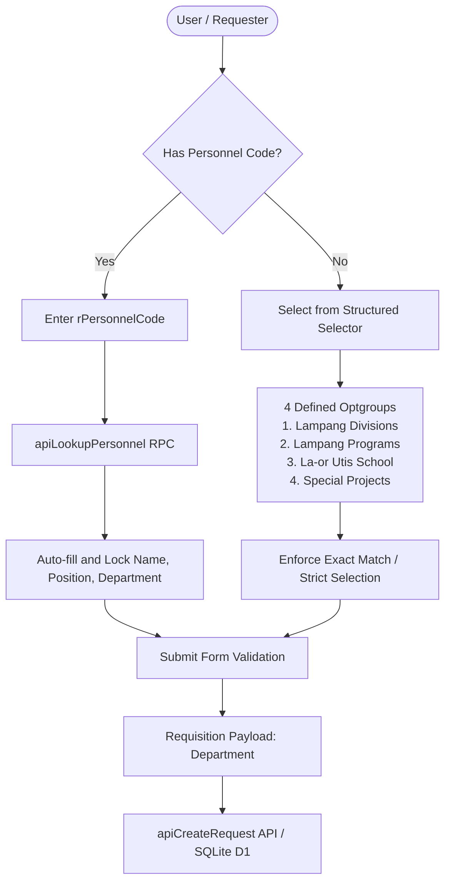

# Requisition Department Selection Hardening

*   **Author:** chookaittom-gif
*   **Status:** Proposed
*   **Date:** 2026-11-09

--------------------------------------------------------------------------------

## Overview

This design hardens the department selection field on the material requisition form (`cloudflare/public/index.html`). It transitions the current free-text combobox input into a strictly validated selection mechanism with clearly structured organizational groups, eliminating typos, ambiguous abbreviations, and invalid entries while maintaining detailed division and program-level tracking for inventory accounting.

## The Problem

Currently, the requisition form allows arbitrary free-text input for `Department` (`หลักสูตร / ฝ่ายงาน / โครงการ`). When requesters search or type manually, entering non-matching text defaults to accepting raw user input. Consequently:
1. Users frequently input typos, non-standard acronyms, or misidentify their administrative unit.
2. An initial proposal suggested reducing the options to only two top-level choices: "ศูนย์ฯ ลำปาง" and "โรงเรียนสาธิตฯ". However, operational analysis revealed that over 95% of requisitions originate from Suan Dusit University Lampang Center, while La-or Utis Demonstration School rarely requests from this central inventory. Collapsing the field into two broad entities would eliminate essential cost-center visibility across academic programs and administrative divisions.
3. The root cause is the permissive free-text input behavior rather than missing categories.

## Goals

*   **Eliminate Invalid Free-Text**: Prevent arbitrary text submission by enforcing selection strictly from predefined authorized organizational units.
*   **Clear Hierarchy & Grouping**: Restructure the unit list into distinct optgroups:
    1. ฝ่ายงาน / สำนักงาน (ศูนย์การศึกษา ลำปาง) - 6 core administrative divisions
    2. สาขาวิชา / หลักสูตร (ศูนย์การศึกษา ลำปาง) - 4 academic programs
    3. โรงเรียนสาธิตละอออุทิศ ลำปาง
    4. โครงการพิเศษ / กิจกรรมโครงการ
*   **Personnel Auto-Fill Consistency**: Maintain full compatibility with the existing Personnel Code (`rPersonnelCode`) lookup which auto-populates and locks verified department values.
*   **Schema & API Invariants**: Keep the `Department` field identifier, database schema, RPC signatures, PDF generation, and notification payloads intact without breaking changes.

## Non-Goals

*   Altering the database column name or migrating existing historical requisition records.
*   Removing department granularity in reports, PDF receipts, or LINE/Telegram notifications.
*   Adding mandatory multi-step cascading forms when a single structured selector fulfills all operational requirements.

## Open Questions

*   None. (Resolved during brainstorming: preserve original departmental granularity while closing the free-text vulnerability).

## Critical User Journeys (CUJs)

### CUJ 1: Manual Requisition Submission with Structured Selector
*   **Given**: A requester opens the requisition form without entering a Personnel Code.
*   **When**: The requester interacts with the department selector.
*   **Then**: The requester chooses from the structured optgroups. If typing to filter, only valid matching options can be chosen; arbitrary free-text cannot be submitted.

### CUJ 2: Fast Requisition with Personnel Code Auto-Fill
*   **Given**: A staff member enters their numeric Personnel Code in `rPersonnelCode`.
*   **When**: The system retrieves the personnel record.
*   **Then**: FullName, Position, and Department are automatically populated and locked into the form, preventing manual entry errors.

--------------------------------------------------------------------------------

## Technical Plan (Architecture)

### Component Architecture & Data Flow



### 1. Form Element & Hierarchy Restructuring

The UI element in `cloudflare/public/index.html` for `Department` will be converted to a strict selection interface with clear visual hierarchy:

```html
<div class="relative">
  <label for="rDept" class="block text-sm font-bold text-slate-700 mb-1.5">
    สังกัด / ฝ่ายงาน / หลักสูตร <span class="text-rose2">*</span>
  </label>
  <select id="rDept" required class="w-full px-4 py-3 min-h-[48px] rounded-2xl border border-slate-200 bg-slate-50/60 focus:bg-white focus:border-brand-500 font-medium text-slate-800 text-sm outline-none transition cursor-pointer">
    <option value="" disabled selected>- กรุณาเลือกสังกัด / ฝ่ายงาน -</option>
    <!-- Groups populated dynamically or statically via structured optgroups -->
  </select>
</div>
```

### 2. Standardized Department Dataset

```javascript
const DEPT_GROUPS = [
  {
    group: '🏢 ฝ่ายงาน / สำนักงาน (ศูนย์ฯ ลำปาง)',
    items: [
      'สำนักงานศูนย์การศึกษา',
      'ฝ่ายงานส่งเสริมวิชาการและงานทะเบียน',
      'ฝ่ายงานพัฒนานักศึกษา',
      'ฝ่ายพัฒนางานวิจัยและนวัตกรรม',
      'ฝ่ายส่งเสริมถ่ายทอดองค์ความรู้ เทคโนโลยีและนวัตกรรม',
      'ฝ่ายอาคารสถานที่ สิ่งแวดล้อม และแหล่งเรียนรู้'
    ]
  },
  {
    group: '🎓 สาขาวิชา / หลักสูตร (ศูนย์ฯ ลำปาง)',
    items: [
      'สาขาวิชาเทคโนโลยีการประกอบอาหารและการบริการ',
      'สาขาวิชาธุรกิจการบิน',
      'สาขาวิชาการศึกษาปฐมวัย',
      'สาขาวิชาการประถมศึกษา'
    ]
  },
  {
    group: '🏫 โรงเรียนสาธิตละอออุทิศ',
    items: [
      'โรงเรียนสาธิตละอออุทิศ ลำปาง'
    ]
  },
  {
    group: '✨ โครงการพิเศษ',
    items: [
      'โครงการพิเศษ / กิจกรรมโครงการ'
    ]
  }
];
```

### 3. State Management & Personnel Auto-Fill Synchronization

*   **Locking Behavior**: When `applyPersonnelToReqForm_` executes, it sets `deptInp.value = p.Department`. If the personnel's department exists in `DEPT_GROUPS`, that option is selected; if not present (legacy exception), an on-the-fly option is temporarily appended and selected to prevent data loss. The element is disabled/read-only with `.disabled = true` and slate background.
*   **Draft Persistence**: `saveReqDraft` and `loadReqDraft` seamlessly save and restore the selected value without requiring any changes to local storage schema.
*   **Form Submission Validation**: Client-side validation in `frmReq.onsubmit` verifies that `reqDept` is non-empty and is a valid authorized option before dispatching `apiCreateRequest`.

--------------------------------------------------------------------------------

## Alternatives Considered

### Alternative A: Binary Dropdown ("ศูนย์ฯ ลำปาง" vs "โรงเรียนสาธิตฯ")
*   **Mechanism**: Reduce the department field to strictly two choices: "ศูนย์ฯ ลำปาง" and "โรงเรียนสาธิตฯ".
*   **Pros**:
    *   Completely eliminates free-text typing.
    *   Minimal choices for the user.
*   **Cons**:
    *   Destroys cost-center and inventory allocation granularity across Lampang Center's 6 divisions and 4 academic majors.
    *   Causes audit issues because inventory reports can no longer reflect which specific department or program consumed the materials.
*   **Reason for Rejection**: Rejected by author: Operational reality indicates that >95% of requisitions are submitted from Suan Dusit University Lampang Center, while La-or Utis Demonstration School rarely requests from this central inventory. Collapsing the field into a binary choice harms the primary use case without providing actionable operational value.

### Alternative B: Two-Tier Cascading Dropdown
*   **Mechanism**: A parent dropdown selecting the entity ("ศูนย์ฯ ลำปาง" vs "โรงเรียนสาธิตฯ") followed by a dynamic child dropdown filtering subdivisions.
*   **Pros**:
    *   Clean separation of organizational hierarchy.
*   **Cons**:
    *   Adds unnecessary friction and multiple touch interactions on mobile devices.
    *   Excessive complexity for an organization where one entity represents the vast majority of transactions.
*   **Reason for Rejection**: Rejected by author: A single native selector with structured `<optgroup>` achieves identical organizational clarity in a single tap without cascading UI state complexity.

### Alternative C: Strict Personnel Code Mandatory Lookup (No Manual Selection)
*   **Mechanism**: Make `Department` 100% read-only and require all users to enter a valid `rPersonnelCode`.
*   **Pros**:
    *   Guarantees that department names always match the official personnel roster.
*   **Cons**:
    *   Blocks requisitions for newly onboarded faculty, adjunct lecturers, or administrative staff whose personnel codes are not yet seeded in SQLite.
*   **Reason for Rejection**: Rejected by author: Unnecessary operational blocker for legitimate departmental operations.

--------------------------------------------------------------------------------

## Detailed Implementation Plan

### 1. Target Files to Modify

#### 1. `cloudflare/public/index.html` (Modify)
*   **Type / Scope**: Client-Side Single Page Application UI & State Controller
*   **Rationale**:
    *   Transform the `#rDept` DOM container from a permissive `<input>` with free-text fallback into a strictly validated selection control featuring structured `<optgroup>` categories.
    *   Update `deptList` data structure to categorize departments into the 4 clear organizational groups.
    *   Ensure `applyPersonnelToReqForm_` correctly assigns, selects, and locks the department when a valid personnel code is looked up.
    *   Ensure `doClearPersonnel_` unlocks and clears the department selector back to default state.
    *   Harden form submit validation (`frmReq.onsubmit`) to ensure the user has selected a valid authorized department before the request payload is constructed.

#### 2. `cloudflare/test/requests.test.ts` (Modify / Verify)
*   **Type / Scope**: Integration & RPC Unit Test Suite
*   **Rationale**:
    *   Verify that `apiCreateRequest` continues to accept valid department names and succeeds under both guest and authenticated roles.
    *   Verify that personnel auto-fill behavior for `Department` remains compliant.

#### 3. `docs/HANDOFF.md` (Modify)
*   **Type / Scope**: Project Continuity & Operational Documentation
*   **Rationale**:
    *   Document the UX enhancement and department selection validation hardening for team visibility and audit trail.

### 2. Verification Plan

*   **Automated Tests**: Run the full automated test suite using `npm test` via RTK proxy (`rtk test npm test`) to confirm zero regressions across all 12 test suites (materials, auth, admin, requests, reports, personnel).
*   **Touch & Mobile Responsiveness**: Verify touch target size exceeds 44px on mobile viewport for `#rDept`.
*   **Personnel Auto-Fill Smoke Test**: Verify that entering a valid personnel code fills and locks the department field, and clicking reset unlocks it.
*   **Draft Persistence Smoke Test**: Verify that selecting a department persists in localStorage and restores properly on refresh.

--------------------------------------------------------------------------------

*Drafted with EGM*
